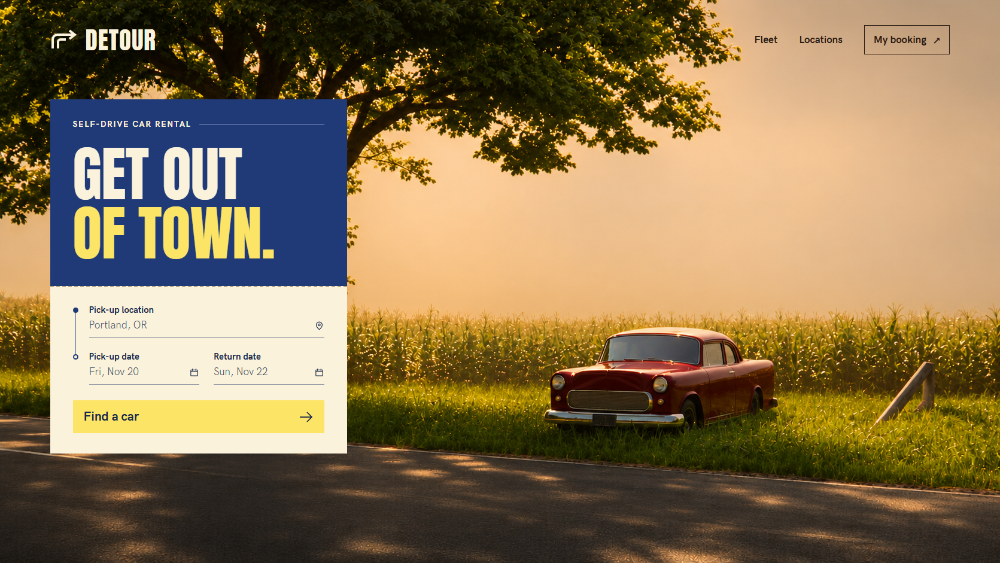

# DETOUR — Self-Drive Vintage & Modern Car Rentals



> **"GET OUT OF TOWN."** — A tactile, mid-century editorial self-drive car rental web experience inspired by classic travel guides, vintage road atlases, and tactile print typography.

---

## 🚗 About Detour

**Detour** is a web application built with **Next.js 16 (App Router)**, **TypeScript**, **Tailwind CSS**, and **Framer Motion**. It captures the romantic golden age of motoring with an authentic vintage print aesthetic: warm cream paper backgrounds (`#F4EBD9`), bold navy headers (`#183059`), solar gold accents (`#F6D04D`), rich forest green details (`#2B580C`), and physical tactile button physics with solid drop-shadow offsets.

### Key Highlights

- **Hero & Curated Getaway Planner:**
  - Full-bleed golden hour landscape background with classic car imagery.
  - Interactive "GET OUT OF TOWN" rental card with Indian regional hubs (Bengaluru Downtown, Mumbai BKC, Delhi Connaught Place, Goa Airport / Panaji, Hyderabad HITEC City, etc.).
  - Custom upward popup calendar date picker with instant preset filters (*This Weekend*, *Next Weekend*, *3-Day Getaway*).
- **Fleet Showcase & Filtering:**
  - Real-time filtering by category: *All Cars*, *Scenic Classics*, *Modern Touring*, *City Agile*, and *Manual Shifters*.
  - Live calculation of daily rates, estimated fuel consumption, transmission specs, and luggage capacity.
- **Scenic Route Atlas (Explore):**
  - Curated scenic drives with mileages, driving durations, and recommended car pairings.
  - Dynamic route inspector with elevation profiles, must-see waypoints, and packing checklists.
- **Seamless Booking Flow & Reservation System:**
  - 3-step tactile reservation pipeline: vehicle selection, driver details & pickup options, itemized invoice with taxes and waiver coverage.
  - Instant booking generation with printable trip packs and reference codes (`DTR-XXXXX`).
  - Account modal with smooth backdrop blurring and seamless sign-in simulation.
- **Tactile UI Physics & Responsive Design:**
  - Bespoke tactile buttons and cards featuring physical drop-shadow press animations (`translate(2px, 2px)` on click).
  - Fully responsive across desktop, tablet, and mobile viewports with custom mobile navigation drawer.
  - Zero `#FFFFFF` pure white across all pages to preserve the authentic tactile newsprint palette.

---

## 🛠️ Tech Stack

- **Framework:** [Next.js 16](https://nextjs.org/) (App Router, Turbopack)
- **Language:** TypeScript
- **Styling:** Tailwind CSS with custom color tokens and vintage paper variables
- **Animations:** Framer Motion (physics spring transitions, interactive hover lifts, modal transitions)
- **Typography:** Anton (bold headlines) and HK Grotesk (editorial body)
- **Icons:** Lucide React

---

## 🚀 Getting Started

### Prerequisites

- Node.js 18.18+ or later
- npm, yarn, or pnpm

### Installation

```bash
# Clone the repository
git clone https://github.com/Deepjyoti78/detour.git
cd detour/detour-app

# Install dependencies
npm install

# Run the development server
npm run dev
```

Open [http://localhost:3000](http://localhost:3000) in your browser to view the application.

### Production Build

```bash
npm run build
npm run start
```

---

## 🌐 Deploy to Vercel

Detour is built with Next.js 16 and deploys seamlessly on [Vercel](https://vercel.com):

1. Go to [Vercel](https://vercel.com/new) and click **Import** for the `detour` repository.
2. Vercel automatically detects the Next.js application in `detour-app`.
3. Keep default settings (Root Directory: `detour-app`) and click **Deploy**.
4. Vercel will install dependencies and create the production deployment with zero manual configuration required.

---

## 📄 License

MIT License. Designed and built with love for classic roads and timeless typography.
