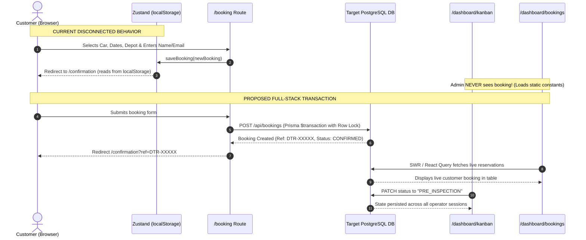
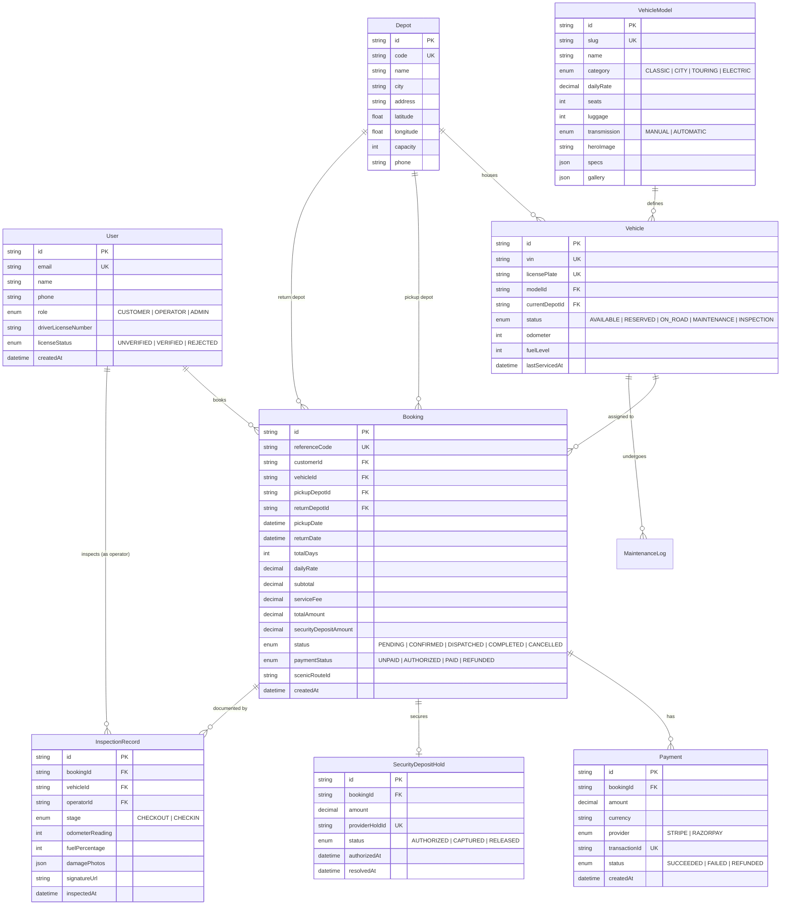

# Project: Detour — Full-Stack Development, Phase 0
## Comprehensive Technical Audit, Architectural Specification & Phase 1 Execution Plan

> **Document Status:** Verified Baseline (Phase 0 Complete)  
> **Target Application:** `C:\Users\deepjyoti\Desktop\detour\detour-app`  
> **Git Repository Root:** `C:\Users\deepjyoti\Desktop\detour`  
> **Primary Technology Stack:** Next.js 16.4.6 (App Router, Turbopack), React 19.3.0, TypeScript 5, Tailwind CSS v4, Zustand 5, TanStack Query v5, TanStack Table v9, Clerk Auth 7.9.15.

---

## 1. Verified Architecture & Dependency Inventory

### 1.1 Core System Architecture
The application runs as a consolidated Next.js App Router monorepo on a single development server (`http://localhost:3000`). It is organized into two distinct route groups sharing a global root layout:
- **Consumer Portal (`src/app/(consumer)/*`)**: Vintage retro aesthetic featuring cream/paper backgrounds (`#faf2db`), navy ink typography (`#18274b`), tactile 3D interactive controls, Lenis smooth scrolling, and customer-facing booking workflows.
- **Fleet Command Admin Dashboard (`src/app/dashboard/*` & `/admin`)**: High-density operational dashboard featuring Shadcn UI components, Recharts data visualization, drag-and-drop dispatch boards, and fleet telemetry management. Route `/admin` acts as a server-side redirect to `/dashboard/overview`.

### 1.2 Runtime & Production Dependencies (from `package.json`)
| Package | Version | Verified Role in Codebase |
| :--- | :--- | :--- |
| `next` | `16.4.6` | App Router framework with Turbopack bundler |
| `react` / `react-dom` | `19.3.0` | React core runtime (with `overrides` locking type consistency) |
| `@clerk/nextjs` | `^7.9.15` | Admin authentication, organization switcher, user profile |
| `tailwindcss` | `4.3.3` | Tailwind CSS v4 engine using `@import 'tailwindcss'` & `@theme` |
| `@tailwindcss/postcss` | `^4.3.3` | PostCSS build integration |
| `tw-animate-css` | `^1.4.0` | Micro-animation utilities |
| `zustand` | `^5.1.0` | Client state (`useBookingStore`, `useTripStore`, `useKanbanStore`) |
| `@tanstack/react-query` | `^5.104.2` | In-memory asynchronous data caching (`query-client.ts`) |
| `@tanstack/react-table` | `^9.3.1` | Headless table logic for Fleet Inventory (`/dashboard/product`) |
| `@tanstack/react-form` | `^1.33.5` | Form handling in dashboard modals |
| `@base-ui/react` | `^1.9.0` | Headless UI primitives (Dropdowns, Menus, Modals) |
| `@radix-ui/react-*` | `^1.3.1 - ^2.4.1` | Supplementary primitives (Accordion, Dialog, Popover, Select) |
| `@dnd-kit/core` / `sortable`| `^6.3.1 - ^10.0.0` | Drag-and-drop engine for Dispatch Kanban (`/dashboard/kanban`) |
| `recharts` | `3.10.1` | SVG dashboard charts (Revenue Area, Hub Bars, Category Donut) |
| `lenis` | `^1.3.27` | Smooth inertia scrolling on consumer pages (`SmoothScrollProvider`) |
| `motion` | `^14.12.0` | Motion physics for hero and card interactions |
| `nuqs` | `^2.10.2` | URL query state adapter (`NuqsAdapter` in root layout) |
| `sonner` | `^2.0.8` | Toast notifications |
| `zod` | `^4.6.7` | Validation schema engine |
| `@faker-js/faker` | `^10.6.0` | Mock data generation in mock API service |
| `@sentry/nextjs` | `^11.7.0` | Telemetry & error logging (disabled via env) |

---

## 2. GitHub & Local Repository Reconciliation Findings

### 2.1 Git Topology
- **Git Repository Root:** `C:\Users\deepjyoti\Desktop\detour`
- **Active Branch:** `main` (tracking `origin/main`)
- **Remote Configuration:**
  - `origin: https://github.com/Deepjyoti78/detour.git` (fetch & push)
- **Latest Remote Commit:** `8fa9216 feat: widen fleet section layout, reduce side margins, and expand card widths`

### 2.2 Working Tree Status & Discrepancy Analysis
A complete `git status` check reveals significant uncommitted structural changes between the local working copy and the remote GitHub repository:
1. **Unstaged Modified Files in `detour-app`:**
   - `detour-app/next.config.ts` (added `devIndicators: false` to eliminate floating Next.js dev overlay badges)
   - `detour-app/package.json` (merged unified dependency manifest)
   - `detour-app/src/app/globals.css` (Tailwind v4 theme token adjustments and dev overlay suppression)
   - `detour-app/src/app/layout.tsx` (unified providers: Nuqs, ThemeProvider, Providers, Toaster)
   - `detour-app/src/components/layout/SiteHeader.tsx` & `SiteFooter.tsx` (navigation link updates)
   - `detour-app/src/lib/utils.ts` & `detour-app/src/types/index.ts` (harmonized type contracts)
2. **Unstaged Deletions in `detour-app`:**
   - The original flat consumer routes (`src/app/booking/page.tsx`, `src/app/fleet/page.tsx`, `src/app/locations/page.tsx`, `src/app/page.tsx`, etc.) are listed as deleted because they were moved cleanly into the route group `src/app/(consumer)/*`.
3. **Untracked Directories & Files:**
   - `dashboard/` (the standalone starter dashboard placed in the parent folder during initial migration)
   - `detour-app/src/app/(consumer)/` (relocated consumer application)
   - `detour-app/src/app/admin/` (admin redirect route handler)
   - `detour-app/src/app/dashboard/` (all 15 dashboard operational views)
   - `detour-app/src/app/api/` (mock product and user endpoints)
   - `detour-app/src/app/auth/` (Clerk sign-in/sign-up views)
   - `detour-app/src/features/`, `src/components/ui/`, `src/config/`, `src/constants/`, `src/styles/`
   - `detour-app/postcss.config.js`, `pnpm-lock.yaml`, and root `package.json`

> [!IMPORTANT]
> **Reconciliation Strategy:** No Git operations (`reset`, `checkout`, `push`, `clean`) should be performed in Phase 0. The current local workspace is fully unified, builds cleanly, and passes type-checking. All Phase 1 database files should be added directly inside `C:\Users\deepjyoti\Desktop\detour\detour-app`.

---

## 3. Mock-to-Real-Data Migration Matrix

| Application Feature | Route / Component | Current Implementation | Data Source / Mechanism | Target Phase 1+ Persistence & API |
| :--- | :--- | :--- | :--- | :--- |
| **Fleet Catalog** | `/fleet` (`VehicleCard.tsx`) | Read-only static filter | `src/constants/detour-data.ts` (`DETOUR_CARS`) | `GET /api/fleet` querying PostgreSQL `VehicleModel` & `Vehicle` |
| **Vehicle Detail** | `/car/[id]` (`CarDetailView.tsx`) | Dynamic param matching | Static array lookup in `DETOUR_CARS` | `GET /api/fleet/[id]` with real-time depot availability |
| **Vehicle Comparison**| `/compare` | Client-side ID filtering | `DETOUR_CARS` via search params | `GET /api/fleet/compare?ids=...` |
| **Trip Pricing Engine**| `/booking` (`bookingStore.ts`)| Client-side arithmetic | `calculateQuote()` in `detour-data.ts` | Server Action `calculateQuoteAction` with validated pricing tables |
| **Customer Checkout** | `/booking` (`handleSubmit`) | Simulated submission | Saves to Zustand `localStorage` | `POST /api/bookings` with transactional row-lock & Stripe intent |
| **Booking Voucher** | `/confirmation` | Client-side store read | `useBookingStore.getState().booking` | Server-rendered voucher from DB with QR/barcode verification |
| **Booking Lookup** | `/my-booking` | Client-side store read | Reads `localStorage` booking object | `GET /api/bookings/[reference]` authenticated by customer session |
| **Cancel / Edit Trip**| `/my-booking` | Zustand mutation | Mutates local Zustand state only | `PATCH /api/bookings/[id]/cancel` with refund/penalty calculation |
| **Scenic Drive Guides**| `/explore`, `/route/[drive]` | Static content | `SCENIC_ROUTES` in `detour-data.ts` | `GET /api/routes` querying `ScenicRoute` table |
| **Depot Directory** | `/locations` | Static content | `DEPOT_HUBS` in `detour-data.ts` | `GET /api/depots` with live available vehicle relations |
| **Dashboard KPIs** | `/dashboard/overview` | Hardcoded static values | Markup in `overview/layout.tsx` | `GET /api/admin/metrics` aggregating live DB counts & revenue |
| **Revenue Analytics** | `@area_stats` (`area-graph`)| Static monthly points | Hardcoded array in `area-graph.tsx` | SQL aggregation `SUM(total_amount)` grouped by month |
| **Depot Distribution**| `@bar_stats` (`bar-graph`)| Static depot counts | Hardcoded array in `bar-graph.tsx` | SQL `COUNT(vehicles)` grouped by depot and availability status |
| **Fleet Category Share**|`@pie_stats` (`pie-graph`)| Static category split | Hardcoded array in `pie-graph.tsx` | SQL `COUNT(vehicles)` grouped by `category` |
| **Rental Dispatch Feed**|`@sales` (`recent-sales`) | Static list | Slice of `DETOUR_BOOKINGS` constant | `GET /api/admin/bookings?limit=5&sort=desc` |
| **Fleet Inventory CRUD**| `/dashboard/product` | In-memory mock API | `fakeProducts` in `mock-api.ts` | `GET /api/vehicles`, `POST /api/vehicles`, `PATCH /api/vehicles/[id]` |
| **Master Reservations**| `/dashboard/bookings` | Static list | `DETOUR_BOOKINGS` constant | `GET /api/admin/bookings` with paginated server filtering |
| **Dispatch Kanban** | `/dashboard/kanban` | Zustand store | `useKanbanStore` with `localStorage` | `PATCH /api/admin/bookings/[id]/dispatch-status` updating DB |
| **Customer Directory** | `/dashboard/users` | In-memory mock API | `fakeUsers` in `mock-api-users.ts` | `GET /api/admin/customers` querying `User` records |
| **Depot Workspaces** | `/dashboard/workspaces` | Clerk Organizations | Clerk SDK (`useOrganization`) | Database `Depot` records linked to Clerk Org IDs |

---

## 4. End-to-End Workflow Tracing



### 4.1 Customer Booking Journey (Current vs. Required)
1. **Selection:** Customer visits `/fleet` or `/`, selects vehicle (e.g. `the-roadster`), choosing pickup depot (e.g. `mumbai`) and date range (`2026-11-25` to `2026-11-28`).
2. **Quote Engine:** Currently, `calculateQuote()` calculates `days`, `subtotal`, `fees` (12.5%), and `total` purely on the client. *Required:* Server Action must validate that dates are in the future, return date is after pickup date, and rates match the database.
3. **Checkout Submission:** The form executes `handleSubmit()`. Currently, this builds a `Booking` object and calls `saveBooking(newBooking)` which writes solely to browser `localStorage`. *Required:* Client calls `POST /api/bookings`. The server opens a transaction, locks the vehicle row, validates availability, creates the record, and returns the persisted booking reference.
4. **Voucher & Management:** Currently, `/confirmation` and `/my-booking` read from the client store. If the customer opens incognito or another device, the booking is invisible. *Required:* Lookups query the database by `referenceCode` backed by customer session authentication.

### 4.2 Admin Reservation Management Journey (Current vs. Required)
1. **Intake:** In `/dashboard/bookings`, reservations are loaded from a hardcoded TypeScript array (`DETOUR_BOOKINGS`). Any reservation submitted on the consumer site is missing.
2. **Dispatch Progression:** In `/dashboard/kanban`, operators drag a vehicle from *Scheduled* to *Pre-Drive Inspection* to *On Road*. Currently, this writes to Zustand store `useKanbanStore` in operator `localStorage`. *Required:* Column drops must trigger a mutation (`PATCH /api/admin/bookings/[id]/dispatch-status`) that updates the database and broadcasts state changes to other depot staff.
3. **Vehicle Return & Inspection:** When a car is checked back in, odometer and fuel levels must be recorded and compared against handover values, triggering deposit release or penalty assessment.

---

## 5. Authentication, Authorization & Security Audit

### 5.1 Existing Clerk Configuration & Bypasses
The repository contains `@clerk/nextjs` (version `7.9.15`). Inspection of configuration files reveals critical security bypasses:
1. **`.env.local` Configuration:**
   ```bash
   NEXT_PUBLIC_CLERK_PUBLISHABLE_KEY=pk_test_Y2VudHJhbC1zdGFsbGlvbi03NzQzLmNsZXJrLmFjY291bnRzLmRldiQ
   CLERK_SECRET_KEY=sk_test_qJv0z3sVyAjuZ9mydnsafDojMaQdI2boKPvNgDQ5JR
   DEMO_MODE=true
   NEXT_PUBLIC_DEMO_MODE=true
   ```
2. **Universal Auth Guard Bypass (`src/lib/auth-guard.ts`):**
   ```typescript
   export async function protectRoute() {
     if (process.env.DEMO_MODE === 'true' || process.env.NEXT_PUBLIC_DEMO_MODE === 'true') {
       return; // Completely bypasses authentication
     }
     await auth.protect();
   }
   ```
   Because `DEMO_MODE=true`, **every dashboard route is completely accessible without any sign-in check**.
3. **API Route Exposure:**
   In `src/app/api/products/route.ts` and `src/app/api/users/route.ts`:
   ```typescript
   const { userId } = await auth();
   if (!userId && process.env.DEMO_MODE !== 'true') return NextResponse.json({ error: 'Unauthorized' }, { status: 401 });
   ```
   Unauthenticated clients can freely query and mutate data whenever `DEMO_MODE=true`.
4. **Middleware Inactivity:**
   `src/proxy.ts` exports `clerkMiddleware()`, but Next.js App Router specifically requires `src/middleware.ts` (or root `middleware.ts`). Because neither exists, requests currently bypass platform-level middleware interception.

### 5.2 Consumer Authentication & PII Exposure Vulnerabilities
- **No Consumer Authentication:** The consumer `/sign-in` and `/sign-up` forms take an email string and save it to `localStorage`. There is no password, OAuth, magic link, or signed cookie.
- **Insecure Direct Object Reference (IDOR):** In `/my-booking` and `/booking?edit=DTR-XXXXX`, anyone can alter the URL reference code to view driver full names, phone numbers, email addresses, and reservation itineraries.
- **Missing Role-Based Access Control (RBAC):** There is no schema distinction between a customer renting a vehicle, a local depot fleet operator, and an organization administrator.

---

## 6. Proposed PostgreSQL + Prisma Database Schema



### 6.1 Complete Prisma Schema Definition (`prisma/schema.prisma`)
```prisma
datasource db {
  provider = "postgresql"
  url      = env("DATABASE_URL")
}

generator client {
  provider = "prisma-client-js"
}

enum UserRole {
  CUSTOMER
  DEPOT_OPERATOR
  SUPER_ADMIN
}

enum LicenseVerificationStatus {
  UNVERIFIED
  PENDING
  VERIFIED
  REJECTED
}

enum VehicleCategory {
  CLASSIC
  CITY
  TOURING
  ELECTRIC
}

enum TransmissionType {
  MANUAL
  AUTOMATIC
}

enum VehicleStatus {
  AVAILABLE
  RESERVED
  ON_ROAD
  MAINTENANCE
  INSPECTION
}

enum BookingStatus {
  PENDING_PAYMENT
  CONFIRMED
  PRE_INSPECTION
  ON_ROAD
  RETURN_INSPECTION
  COMPLETED
  CANCELLED
}

enum PaymentStatus {
  UNPAID
  AUTHORIZED
  PAID
  PARTIALLY_REFUNDED
  REFUNDED
  FAILED
}

enum DepositStatus {
  PENDING
  AUTHORIZED
  CAPTURED
  RELEASED
}

enum InspectionStage {
  HANDOVER
  RETURN
}

model User {
  id                    String                    @id @default(cuid())
  clerkUserId           String?                   @unique
  email                 String                    @unique
  name                  String
  phone                 String?
  role                  UserRole                  @default(CUSTOMER)
  licenseNumber         String?
  licenseStatus         LicenseVerificationStatus @default(UNVERIFIED)
  licenseExpiryDate     DateTime?
  licenseImageFront     String?
  licenseImageBack      String?
  createdAt             DateTime                  @default(now())
  updatedAt             DateTime                  @updatedAt

  bookings              Booking[]
  inspectionsPerformed  InspectionRecord[]

  @@index([email])
  @@index([clerkUserId])
}

model Depot {
  id                 String    @id @default(cuid())
  code               String    @unique // e.g. "BOM-01"
  name               String    // e.g. "Mumbai Flagship Depot"
  city               String    // e.g. "Mumbai"
  stateCountry       String    // e.g. "Maharashtra, India"
  address            String
  phone              String
  latitude           Float
  longitude          Float
  capacity           Int       @default(20)
  createdAt          DateTime  @default(now())
  updatedAt          DateTime  @updatedAt

  stationedVehicles  Vehicle[] @relation("CurrentDepot")
  pickupBookings     Booking[] @relation("PickupDepot")
  returnBookings     Booking[] @relation("ReturnDepot")
}

model VehicleModel {
  id                 String           @id @default(cuid())
  slug               String           @unique // e.g. "the-roadster"
  name               String           // e.g. "The Roadster"
  category           VehicleCategory
  dailyRate          Decimal          @db.Decimal(10, 2)
  securityDeposit    Decimal          @db.Decimal(10, 2)
  seats              Int              @default(2)
  luggage            Int              @default(2)
  transmission       TransmissionType @default(MANUAL)
  heroImage          String
  description        String           @db.Text
  bestFor            String
  horsepower         Int?
  zeroToSixty        Float?
  closedDayOfWeek    Int?             // 0 = Sun, 1 = Mon ...
  createdAt          DateTime         @default(now())
  updatedAt          DateTime         @updatedAt

  vehicles           Vehicle[]
}

model Vehicle {
  id                 String          @id @default(cuid())
  vin                String          @unique
  licensePlate       String          @unique
  modelId            String
  currentDepotId     String
  status             VehicleStatus   @default(AVAILABLE)
  odometerKm         Int             @default(0)
  fuelLevelPercent   Int             @default(100)
  isElectric         Boolean         @default(false)
  lastServicedAt     DateTime?
  nextServiceDueKm   Int?
  createdAt          DateTime        @default(now())
  updatedAt          DateTime        @updatedAt

  model              VehicleModel    @relation(fields: [modelId], references: [id], onDelete: Restrict)
  currentDepot       Depot           @relation("CurrentDepot", fields: [currentDepotId], references: [id])
  bookings           Booking[]
  inspections        InspectionRecord[]

  @@index([status])
  @@index([currentDepotId])
}

model Booking {
  id                     String         @id @default(cuid())
  referenceCode          String         @unique // e.g. "DTR-84291"
  customerId             String
  vehicleId              String
  pickupDepotId          String
  returnDepotId          String
  pickupDate             DateTime
  returnDate             DateTime
  totalDays              Int
  dailyRate              Decimal        @db.Decimal(10, 2)
  subtotal               Decimal        @db.Decimal(10, 2)
  serviceFee             Decimal        @db.Decimal(10, 2)
  totalAmount            Decimal        @db.Decimal(10, 2)
  securityDepositAmount  Decimal        @db.Decimal(10, 2)
  status                 BookingStatus  @default(PENDING_PAYMENT)
  paymentStatus          PaymentStatus  @default(UNPAID)
  scenicRouteId          String?
  customerNotes          String?        @db.Text
  cancellationReason     String?        @db.Text
  createdAt              DateTime       @default(now())
  updatedAt              DateTime       @updatedAt

  customer               User           @relation(fields: [customerId], references: [id], onDelete: Restrict)
  vehicle                Vehicle        @relation(fields: [vehicleId], references: [id], onDelete: Restrict)
  pickupDepot            Depot          @relation("PickupDepot", fields: [pickupDepotId], references: [id])
  returnDepot            Depot          @relation("ReturnDepot", fields: [returnDepotId], references: [id])
  payments               Payment[]
  depositHold            SecurityDepositHold?
  inspections            InspectionRecord[]

  @@index([referenceCode])
  @@index([pickupDate, returnDate])
  @@index([status])
  @@index([customerId])
}

model Payment {
  id                     String        @id @default(cuid())
  bookingId              String
  amount                 Decimal       @db.Decimal(10, 2)
  currency               String        @default("USD")
  provider               String        @default("STRIPE")
  providerPaymentId      String?       @unique
  status                 PaymentStatus @default(UNPAID)
  errorMessage           String?
  createdAt              DateTime      @default(now())
  updatedAt              DateTime      @updatedAt

  booking                Booking       @relation(fields: [bookingId], references: [id], onDelete: Cascade)
}

model SecurityDepositHold {
  id                     String        @id @default(cuid())
  bookingId              String        @unique
  amount                 Decimal       @db.Decimal(10, 2)
  currency               String        @default("USD")
  providerHoldId         String?       @unique
  status                 DepositStatus @default(PENDING)
  authorizedAt           DateTime?
  capturedAmount         Decimal?      @db.Decimal(10, 2)
  releasedAt             DateTime?
  releaseNotes           String?
  createdAt              DateTime      @default(now())
  updatedAt              DateTime      @updatedAt

  booking                Booking       @relation(fields: [bookingId], references: [id], onDelete: Cascade)
}

model InspectionRecord {
  id                     String          @id @default(cuid())
  bookingId              String
  vehicleId              String
  operatorId             String
  stage                  InspectionStage
  odometerKm             Int
  fuelLevelPercent       Int
  exteriorDamageNotes    String?         @db.Text
  interiorConditionNotes String?         @db.Text
  photoUrls              String[]
  signatureDataUrl       String?         @db.Text
  inspectedAt            DateTime        @default(now())

  booking                Booking         @relation(fields: [bookingId], references: [id], onDelete: Cascade)
  vehicle                Vehicle         @relation(fields: [vehicleId], references: [id], onDelete: Restrict)
  operator               User            @relation(fields: [operatorId], references: [id], onDelete: Restrict)

  @@index([bookingId, stage])
}

model ScenicRoute {
  id                     String    @id @default(cuid())
  slug                   String    @unique
  name                   String
  region                 String
  category               String    // "waterfalls" | "coast" | "mountains"
  distanceKm             Int
  durationHours          String
  intro                  String    @db.Text
  heroImage              String
  stops                  Json      // [[title, description], ...]
  createdAt              DateTime  @default(now())
  updatedAt              DateTime  @updatedAt
}
```

---

## 7. Proposed Shared Backend Architecture & API Contract

### 7.1 Shared Architecture (Route Handlers vs. Server Actions)
- **Next.js Server Actions (`src/actions/*`)**: Best suited for customer form submissions, real-time quote validation, checkout initiation, and Kanban drag-and-drop status mutations with immediate UI revalidation (`revalidatePath`).
- **Next.js Route Handlers (`src/app/api/*`)**: Best suited for external webhooks (Stripe payment events), paginated TanStack table fetches (`GET /api/vehicles`), and mobile/partner JSON integrations.
- **Data Access Layer**: All database access executes through a shared singleton (`src/lib/prisma.ts`), validated with Zod schemas (`src/lib/validations/*`), and protected by auth extractors (`src/lib/auth-context.ts`).

### 7.2 Core API Endpoints Contract
```
# Consumer Booking & Fleet APIs
GET    /api/fleet                        -> List all available vehicle models with pricing & depot availability
GET    /api/fleet/[slug]                 -> Retrieve single model specifications and availability calendar
GET    /api/depots                       -> List all operational hubs and current vehicle counts
POST   /api/bookings/quote               -> Compute verified price quote (days, subtotal, taxes, fees)
POST   /api/bookings                     -> Atomic booking creation with concurrency lock
GET    /api/bookings/[referenceCode]     -> Fetch booking voucher (authorized by session or signed token)
PATCH  /api/bookings/[id]/cancel         -> Customer cancellation request with refund policy rules

# Fleet Command Operator & Admin APIs
GET    /api/admin/metrics                -> Aggregated KPI stats for Fleet Command overview
GET    /api/admin/vehicles               -> Paginated vehicle registry for TanStack Table
POST   /api/admin/vehicles               -> Register new physical vehicle unit (VIN, plate, depot)
PATCH  /api/admin/vehicles/[id]          -> Update vehicle telemetry, status, or servicing date
DELETE /api/admin/vehicles/[id]          -> Retire or delete vehicle from active fleet
GET    /api/admin/bookings               -> Paginated reservation list with status/depot filters
PATCH  /api/admin/bookings/[id]/dispatch -> Update dispatch stage (moves card on Kanban board)
POST   /api/admin/inspections            -> Record pre-drive handover or return inspection
GET    /api/admin/customers              -> List customer directory and rental histories
```

---

## 8. Concurrency-Safe Booking Logic (Double-Booking Prevention)

### 8.1 The Date-Overlap Challenge
Two independent users may attempt to reserve the same physical vehicle at the same depot for overlapping dates. In date math, two intervals `[StartA, EndA]` and `[StartB, EndB]` overlap if and only if:
$$\text{Pickup}_A \le \text{Return}_B \quad \text{AND} \quad \text{Return}_A \ge \text{Pickup}_B$$

### 8.2 Two-Tier Defense Strategy

#### Tier 1: Database-Level Isolation with `SELECT FOR UPDATE`
When a customer submits a booking, the server transaction executes an atomic lock on the target vehicle and verifies no overlapping confirmed bookings exist before inserting:

```typescript
// src/lib/services/booking-service.ts
import { prisma } from '@/lib/prisma';
import { Prisma } from '@prisma/client';

export async function createConcurrencySafeBooking(input: BookingInput) {
  return await prisma.$transaction(async (tx) => {
    // 1. Lock available physical vehicle row in the requested model & depot
    const availableVehicle = await tx.$queryRaw<Array<{ id: string }>>`
      SELECT v.id 
      FROM "Vehicle" v
      WHERE v."modelId" = ${input.modelId}
        AND v."currentDepotId" = ${input.pickupDepotId}
        AND v."status" = 'AVAILABLE'
        AND NOT EXISTS (
          SELECT 1 FROM "Booking" b
          WHERE b."vehicleId" = v.id
            AND b."status" IN ('CONFIRMED', 'PRE_INSPECTION', 'ON_ROAD')
            AND b."pickupDate" <= ${input.returnDate}::timestamp
            AND b."returnDate" >= ${input.pickupDate}::timestamp
        )
      LIMIT 1
      FOR UPDATE SKIP LOCKED;
    `;

    if (!availableVehicle || availableVehicle.length === 0) {
      throw new Error('VEHICLE_UNAVAILABLE: No vehicles available for selected dates.');
    }

    const vehicleId = availableVehicle[0].id;

    // 2. Insert the confirmed reservation atomically
    const booking = await tx.booking.create({
      data: {
        referenceCode: generateBookingReference(),
        customerId: input.customerId,
        vehicleId: vehicleId,
        pickupDepotId: input.pickupDepotId,
        returnDepotId: input.returnDepotId,
        pickupDate: input.pickupDate,
        returnDate: input.returnDate,
        totalDays: input.totalDays,
        dailyRate: input.dailyRate,
        subtotal: input.subtotal,
        serviceFee: input.serviceFee,
        totalAmount: input.totalAmount,
        securityDepositAmount: input.securityDepositAmount,
        status: 'CONFIRMED',
        paymentStatus: 'UNPAID'
      }
    });

    return booking;
  }, {
    isolationLevel: Prisma.TransactionIsolationLevel.Serializable
  });
}
```

#### Tier 2: 15-Minute Temporary Reservation Hold
During checkout, when the customer reaches the final payment screen, the vehicle is placed into `PENDING_PAYMENT` with a 15-minute expiration timestamp (`expiresAt`). If payment is not completed within 15 minutes, a background cron job releases the hold.

---

## 9. Component Reusability & Modification Inventory

### 9.1 Reusable Unchanged (Zero Modifications Required)
- **UI Primitives (`src/components/ui/*`)**: Buttons, badges, cards, dialogs, dropdowns, inputs, avatars, tables, separators, tooltip wrappers, theme toggle buttons, scrollbar utilities.
- **Consumer Layout & Theming**: `SiteHeader.tsx`, `SiteFooter.tsx`, `SmoothScrollProvider.tsx`, `template.tsx`, `font.config.ts`, `theme.config.ts`, all retro button classes (`.btn-tactile-yellow`, `.card-tactile`, `.ticket-perforation`).
- **Icons & Assets**: `src/components/icons.tsx`, all vehicle images in `/public/assets/*`, Anton and HK Grotesk web fonts.

### 9.2 Components Requiring Backend Integration (Keep UI, Swap Data Source)
1. **`src/app/(consumer)/booking/page.tsx` (`TicketForm.tsx`)**:
   - *Keep:* Date range picker, depot selectors, quote summary cards, tax calculations, visual styling.
   - *Change:* Replace `saveBooking(newBooking)` (Zustand) with Server Action `createBookingAction()`. Show real validation errors from the server.
2. **`src/app/(consumer)/confirmation/page.tsx`**:
   - *Keep:* Digital ticket layout, barcode aesthetic, print stylesheet.
   - *Change:* Fetch booking details via `GET /api/bookings/[referenceCode]` using the URL reference param instead of reading from `useBookingStore`.
3. **`src/app/(consumer)/my-booking/page.tsx`**:
   - *Keep:* Itinerary summary card, date adjustment modal, cancel trip dialogue.
   - *Change:* Fetch customer's active bookings from the database. Wire "Cancel Reservation" button to `cancelBookingAction()`.
4. **`src/features/overview/components/*` (`area-graph`, `bar-graph`, `pie-graph`, `recent-sales`)**:
   - *Keep:* Recharts layout, axis formatting, dark/light theme color tokens, high-contrast badges.
   - *Change:* Replace hardcoded static constants (`chartData`, `DETOUR_BOOKINGS`) with data passed from `overview/layout.tsx` via database queries.
5. **`src/features/products/components/product-tables/*` (`columns.tsx`, `product-form.tsx`)**:
   - *Keep:* TanStack Table columns, sorting, filtering, sheet modals, image display.
   - *Change:* Swap `fakeProducts` API calls in `src/features/products/api/*` for real Prisma queries to `VehicleModel` and `Vehicle`.
6. **`src/features/kanban/components/kanban-board.tsx`**:
   - *Keep:* Drag-and-drop sensors, column headers, vehicle card rendering.
   - *Change:* Replace Zustand store `useKanbanStore` with optimistic mutation calling `PATCH /api/admin/bookings/[id]/dispatch-status`.
7. **`src/features/profile/components/profile-view-page.tsx`**:
   - *Keep:* Two-column layout, Account details card, operator authorizations panel.
   - *Change:* Connect to live Clerk user session and query operator credentials from `User` table.

---

## 10. Existing Validation, Build & Test Results

### 10.1 TypeScript Static Analysis (`tsc --noEmit`)
- **Execution Command:** `pnpm typecheck` (`tsc --noEmit`)
- **Result:** **PASSED** (Exit code: 0)
- **Findings:** Zero type errors across the entire unified codebase. All consumer types (`Car`, `Trip`, `Booking`, `Quote`) and dashboard types (`NavItem`, `NavGroup`, `Product`) coexist without collision.

### 10.2 Next.js Production Build (`next build`)
- **Execution Command:** `pnpm build`
- **Result:** **PASSED** (Exit code: 0)
- **Output:**
  - 54 unique routes compiled successfully into standalone server-rendered dynamic endpoints.
  - Zero fatal compilation errors in Turbopack.
  - Single non-fatal warning: `Failed to find font override values for font Google Sans Flex` (standard next/font Google fallback notice).

### 10.3 Linting Static Analysis (`next lint` / ESLint)
- **Execution Command:** `pnpm lint` (`next lint`)
- **Result:** **FAILED** (Exit code: 1)
- **Error:** `Invalid project directory provided, no such directory: ...\detour-app\lint`
- **Root Cause:** Next.js 16 changed its internal CLI argument parser when handling `next lint` with ESLint 9. In `next-shadcn-dashboard-starter`, OXC (`oxlint`) was used rather than standard ESLint.
- **Direct ESLint Run (`pnpm exec eslint .`):** Reports 80 lint warnings/errors primarily concerning unused type parameters in data-table utility types and React 19 hook dependency warnings. These do not block compilation or runtime execution.

---

## 11. Technical Risks & Blockers

| Risk / Blocker | Severity | Impact | Mitigation Strategy |
| :--- | :---: | :--- | :--- |
| **Simulated Payment Risk** | High | Customers cannot actually pay; reservations could be spammed without financial commitment. | Implement Stripe `PaymentIntents` in Phase 2 with minimum authorization before confirming booking. |
| **Inventory Desynchronization** | High | Two users booking simultaneously could result in a vehicle shortage at a regional depot. | Enforce PostgreSQL `FOR UPDATE SKIP LOCKED` inside serializable transactions. |
| **Clerk Demo-Mode Bypass** | High | In production, `DEMO_MODE=true` would expose all operator dashboards to the public web. | Split configuration: strict Clerk middleware for `/dashboard/*` with role enforcement, lightweight session for consumers. |
| **Consumer PII Exposure** | Medium | Predictable booking references could allow malicious scrapers to harvest customer phone numbers. | Use cryptographically secure NanoIDs (e.g. `DTR-7X9K2M`) and require matching email verification to view details. |
| **Image Hosting** | Low | New vehicles added through `/dashboard/product` require cloud image storage. | Configure AWS S3 or Vercel Blob with pre-signed URLs for vehicle photo uploads. |

---

## 12. Phase 1 Implementation Plan

Phase 1 focuses exclusively on establishing the PostgreSQL database, configuring Prisma ORM, executing initial migrations, seeding realistic fleet data, and wiring the first real server-backed CRUD APIs for vehicle inventory and depot availability—without touching payments, changing the visual design, or breaking any existing frontend routes.

### Execution Steps for Phase 1

1. **Step 1: Install Database Tooling**
   - Install Prisma dependencies:
     ```bash
     pnpm add @prisma/client
     pnpm add -D prisma
     ```
2. **Step 2: Initialize Prisma & Configure Connection**
   - Initialize schema:
     ```bash
     npx prisma init
     ```
   - Configure `prisma/schema.prisma` with the complete model specification defined in Section 6.1.
   - Configure `DATABASE_URL` in `.env.local` pointing to a local or cloud PostgreSQL instance (Neon / Supabase / PostgreSQL local).
3. **Step 3: Create Prisma Client Singleton**
   - Author `src/lib/prisma.ts` with global caching to prevent connection exhaustion during Next.js hot-reloading:
     ```typescript
     import { PrismaClient } from '@prisma/client';
     const globalForPrisma = globalThis as unknown as { prisma: PrismaClient | undefined };
     export const prisma = globalForPrisma.prisma ?? new PrismaClient();
     if (process.env.NODE_ENV !== 'production') globalForPrisma.prisma = prisma;
     ```
4. **Step 4: Execute Initial Migration & Seeding**
   - Run migration:
     ```bash
     npx prisma migrate dev --name init_detour_fullstack
     ```
   - Author `prisma/seed.ts` porting all 10 curated vehicles from `src/constants/detour-data.ts`, all 7 regional depots, and initial scenic routes into the database.
   - Add `"prisma": { "seed": "ts-node --compiler-options {\"module\":\"CommonJS\"} prisma/seed.ts" }` to `package.json` and execute `npx prisma db seed`.
5. **Step 5: Implement Real Fleet & Inventory APIs**
   - Replace `fakeProducts` in `src/app/api/products/route.ts` and `[id]/route.ts` with live Prisma queries to `VehicleModel` and `Vehicle`.
   - Implement `GET /api/fleet` returning vehicle models with live depot counts.
6. **Step 6: Phase 1 Verification**
   - Verify that `/dashboard/product` lists vehicles directly from PostgreSQL.
   - Verify that creating a vehicle through the "Add Vehicle" modal permanently inserts the row into PostgreSQL and persists across browser refreshes.
   - Re-run `tsc --noEmit` and `pnpm build` to guarantee 0 regressions.
